<a href="https://hudsonforgetechnology.com">
<picture>
<source media="(prefers-reduced-motion: reduce)" srcset="assets/hudson-forge-banner.webp">
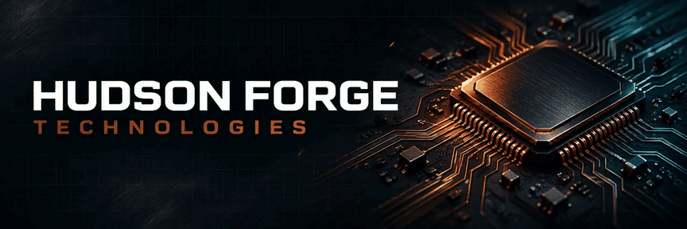
</picture>
</a>

<h1><picture>
<source media="(prefers-reduced-motion: reduce)" srcset="assets/motion/greeting.png">

</picture></h1>

**Independent AI researcher and founder of Hudson Forge Technologies**

I build AI systems that record how decisions are made and research tools that make results reproducible. My background in manufacturing also drives my work on workplace injury prevention.

[Company website](https://hudsonforgetechnology.com) · [Interactive portfolio](https://billyrdavis1985-bot.github.io/billyrdavis1985-bot/) · [Browse all repositories](https://github.com/billyrdavis1985-bot?tab=repositories)

## Explore my work

<table>
<tr>
<td width="50%"><a href="docs/projects/ai-agents.md"><picture><source media="(max-width: 640px)" srcset="assets/categories/ai-agents-compact.svg"></picture></a></td>
<td width="50%"><a href="docs/projects/quantum.md"><picture><source media="(max-width: 640px)" srcset="assets/categories/quantum-compact.svg">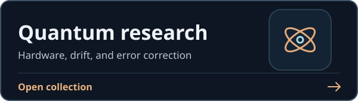</picture></a></td>
</tr>
<tr>
<td width="50%"><a href="docs/projects/safety-data.md"><picture><source media="(max-width: 640px)" srcset="assets/categories/safety-data-compact.svg">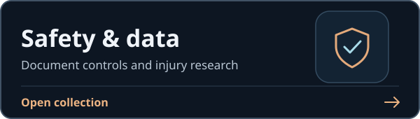</picture></a></td>
<td width="50%"><a href="docs/projects/tools.md"><picture><source media="(max-width: 640px)" srcset="assets/categories/tools-compact.svg">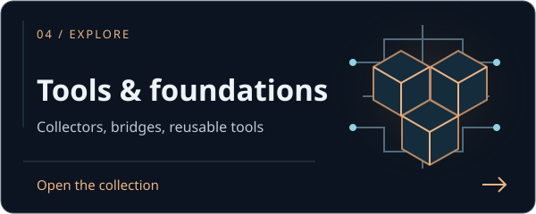</picture></a></td>
</tr>
</table>

[All collections](docs/projects/README.md) · [Complete public repository directory](https://github.com/billyrdavis1985-bot/billyrdavis1985-bot/blob/profile-updates/UPDATES.md#repository-statistics)

## Current research

<a href="docs/current-research.md">
<picture>
<source media="(max-width: 640px)" srcset="https://raw.githubusercontent.com/billyrdavis1985-bot/billyrdavis1985-bot/profile-updates/research-focus-mobile.svg">
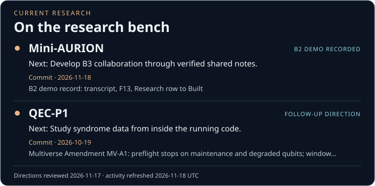
</picture>
</a>

[Directions and supporting evidence](docs/current-research.md) · [Daily repository updates](https://github.com/billyrdavis1985-bot/billyrdavis1985-bot/blob/profile-updates/UPDATES.md#current-research)

## Built day by day

<a href="https://github.com/billyrdavis1985-bot/billyrdavis1985-bot/blob/profile-updates/UPDATES.md#contribution-skyline">
<picture>
<source media="(prefers-reduced-motion: reduce)" srcset="https://raw.githubusercontent.com/billyrdavis1985-bot/billyrdavis1985-bot/profile-updates/contribution-skyline-static.svg">
</picture>
</a>

[View calendar data](https://github.com/billyrdavis1985-bot/billyrdavis1985-bot/blob/profile-updates/contributions.json) · [Static view](https://raw.githubusercontent.com/billyrdavis1985-bot/billyrdavis1985-bot/profile-updates/contribution-skyline-static.svg) · [How it works](docs/profile-visuals.md)

## ForgeVigil in action

An animated summary of a recorded offline run with fictional cases, a fixture assessor, and a scripted operator release.

<picture>
<source media="(prefers-reduced-motion: reduce)" srcset="assets/demos/forgevigil-demo.png">
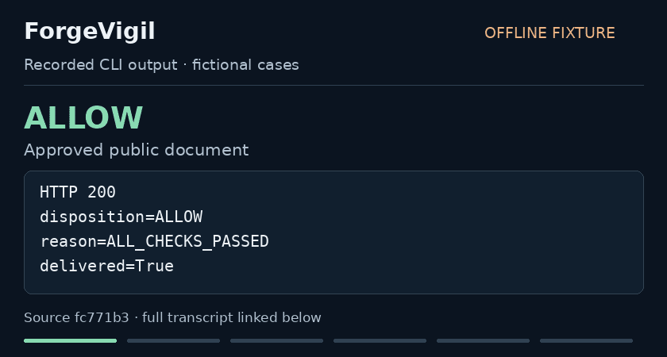
</picture>

[Full transcript and reproduction steps](docs/forgevigil-demo.md) · [Try the interactive walkthrough](https://forgevigil.com)

## Project gallery

Six selected projects. [Explore the full public collection, including forks](https://github.com/billyrdavis1985-bot/billyrdavis1985-bot/blob/profile-updates/UPDATES.md#repository-statistics).

<table>
<tr>
<td width="50%" valign="top">

An AI agent investigates document requests. Code verifies evidence, applies policy, and records each decision.

<a href="https://github.com/billyrdavis1985-bot/ForgeVigil">Code</a> · <a href="https://forgevigil.com">Try demo</a> · <a href="https://forgevigil.com/evidence">Results</a>

</td>
<td width="50%" valign="top">
<a href="https://github.com/billyrdavis1985-bot/forge-agent">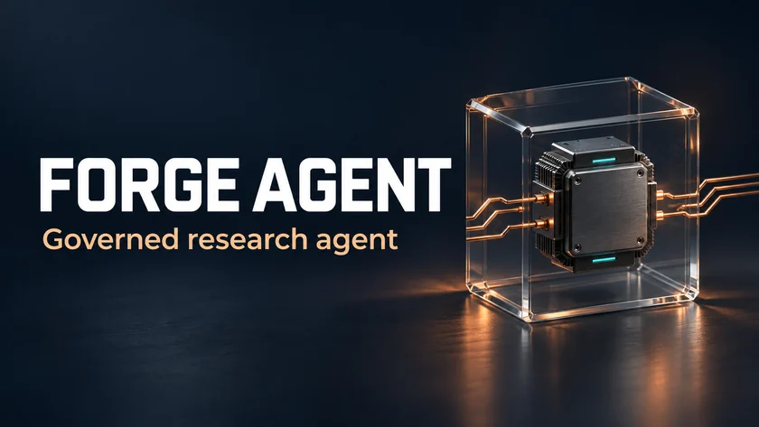</a>

Sandboxed evaluations of local reasoning critics, with pinned models and a traceable evidence chain.

<a href="https://github.com/billyrdavis1985-bot/forge-agent">Code</a> · <a href="https://github.com/billyrdavis1985-bot/forge-agent#quickstart">Quick start</a>

</td>
</tr>
<tr>
<td width="50%" valign="top">
<a href="https://github.com/billyrdavis1985-bot/hf-critic">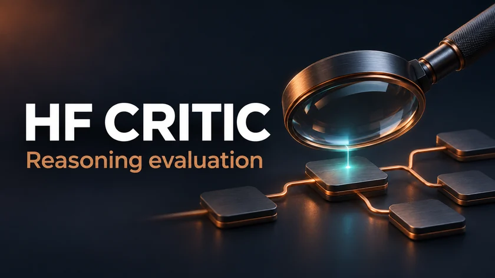</a>

Fine-tuned Qwen and Mistral models evaluated on reasoning critiques and output structure.

<a href="https://github.com/billyrdavis1985-bot/hf-critic">Code</a> · <a href="https://github.com/billyrdavis1985-bot/hf-critic#results">Results</a> · <a href="https://github.com/billyrdavis1985-bot/hf-critic#metric-audit">Metric audit</a>

</td>
<td width="50%" valign="top">
<a href="https://github.com/billyrdavis1985-bot/HF-IQR-V3">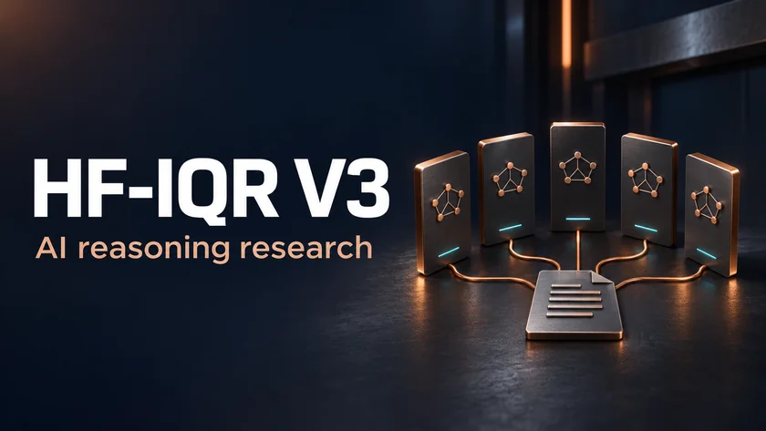</a>

A preregistered study of how five language models critique answers under a forced-counterargument protocol.

<a href="https://github.com/billyrdavis1985-bot/HF-IQR-V3">Code</a> · <a href="https://github.com/billyrdavis1985-bot/HF-IQR-V3#overview">Study</a> · <a href="https://github.com/billyrdavis1985-bot/HF-IQR-V3/tree/main/HF_IQR_V3_PUBLISH/data">Data</a>

</td>
</tr>
<tr>
<td width="50%" valign="top">
<a href="https://github.com/billyrdavis1985-bot/IRMB_QNN-P1_DriftArchive_HardwareValidation">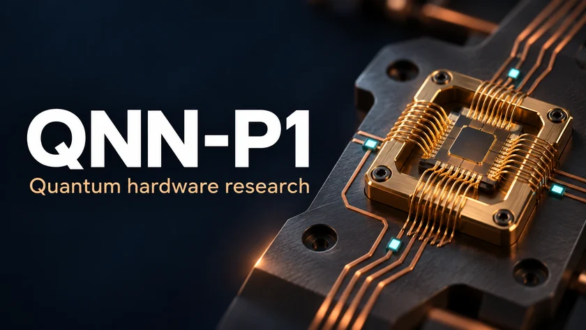</a>

A Raspberry Pi calibration archive used to model IBM quantum hardware. Two test results matched within 0.5 percentage points using run-day calibration.

<a href="https://github.com/billyrdavis1985-bot/IRMB_QNN-P1_DriftArchive_HardwareValidation">Code</a> · <a href="https://github.com/billyrdavis1985-bot/IRMB_QNN-P1_DriftArchive_HardwareValidation/blob/main/PAPER.md">Paper</a> · <a href="https://github.com/billyrdavis1985-bot/IRMB_QNN-P1_DriftArchive_HardwareValidation/blob/main/REPRODUCE.md">Reproduce</a>

</td>
<td width="50%" valign="top">
<a href="https://github.com/billyrdavis1985-bot/WIPS-Preflight-OSHA-2024">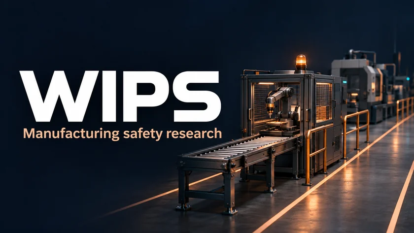</a>

Manufacturing injury-risk research using public OSHA records, with a dashboard prototype running on synthetic data.

<a href="https://github.com/billyrdavis1985-bot/WIPS-Preflight-OSHA-2024">Code</a> · <a href="https://github.com/billyrdavis1985-bot/WIPS-Preflight-OSHA-2024/tree/main/phase-1-preflight">Research</a> · <a href="https://github.com/billyrdavis1985-bot/WIPS-Preflight-OSHA-2024/tree/main/phase-3-decision-support">Prototype</a>

</td>
</tr>
</table>

## Project map

[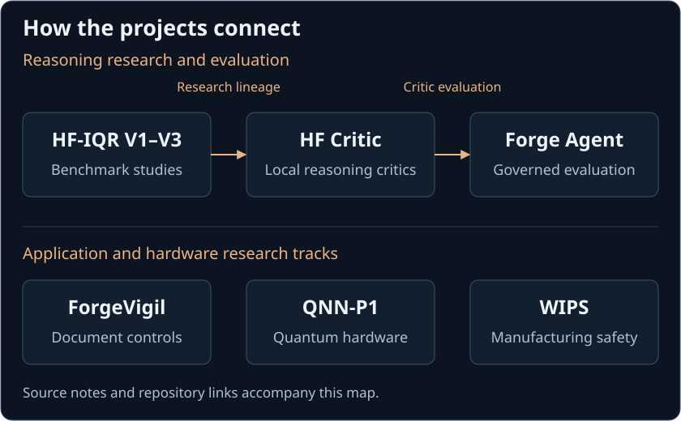](docs/project-map.md)

[Explore the connections and source notes](docs/project-map.md)

## Repository statistics

[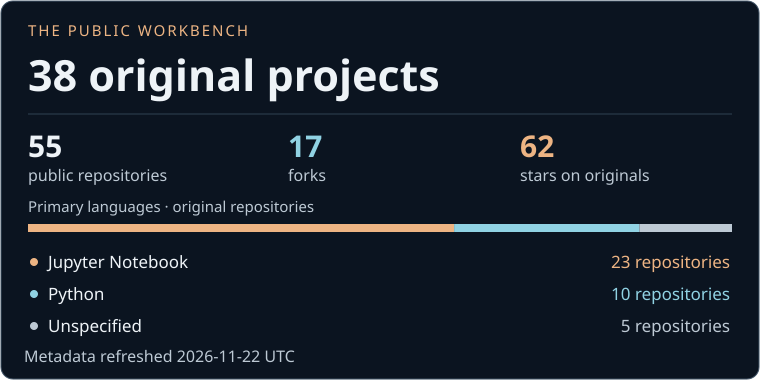](https://github.com/billyrdavis1985-bot/billyrdavis1985-bot/blob/profile-updates/UPDATES.md#repository-statistics)

[View repository statistics](https://github.com/billyrdavis1985-bot/billyrdavis1985-bot/blob/profile-updates/UPDATES.md#repository-statistics)

## Latest project updates

[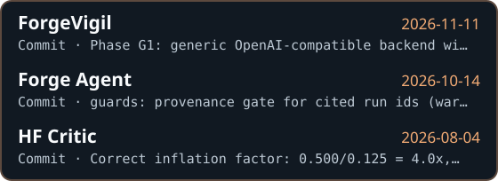](https://github.com/billyrdavis1985-bot/billyrdavis1985-bot/blob/profile-updates/UPDATES.md#latest-project-updates)

[See all six project updates](https://github.com/billyrdavis1985-bot/billyrdavis1985-bot/blob/profile-updates/UPDATES.md#latest-project-updates)

QNN-P1 · Compare simulation and hardware results

[More IRMB research on framing in AI reasoning](https://github.com/billyrdavis1985-bot/mtca-research) · [Quantum coordination experiments](https://github.com/billyrdavis1985-bot/IRMB_Phase7G_Design5_QuantumCausality)
