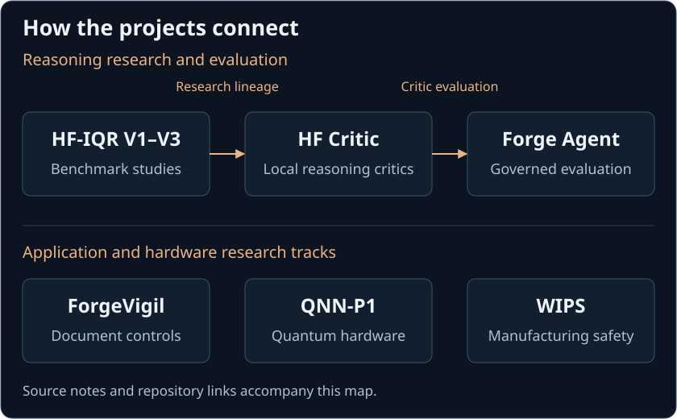

# Public project map

The arrows show research lineage and evaluation roles in the reasoning projects. The lower row groups three application and hardware research tracks.

| Connection | Source |
| --- | --- |
| HF-IQR V1–V3 → HF Critic | HF Critic describes the HF-IQR studies as its methodological foundation and reserves the benchmark for evaluation. [HF Critic README](https://github.com/billyrdavis1985-bot/hf-critic/blob/b4b1c9db33277fc20df4427edae59051bff04bdb/README.md) |
| HF Critic → Forge Agent | HF Critic names Forge Agent as downstream work. Forge Agent describes its role in evaluating locally hosted, fine-tuned reasoning critics. [HF Critic README](https://github.com/billyrdavis1985-bot/hf-critic/blob/b4b1c9db33277fc20df4427edae59051bff04bdb/README.md) · [Forge Agent README](https://github.com/billyrdavis1985-bot/forge-agent/blob/7260518e7090b1f8df391afbb112f570b4618f51/README.md) |

| Track | Public project |
| --- | --- |
| Document controls | [ForgeVigil](https://github.com/billyrdavis1985-bot/ForgeVigil) investigates outgoing document requests and records policy decisions. |
| Quantum hardware | [QNN-P1](https://github.com/billyrdavis1985-bot/IRMB_QNN-P1_DriftArchive_HardwareValidation) studies calibration-based simulation and IBM hardware results. |
| Manufacturing safety | [WIPS](https://github.com/billyrdavis1985-bot/WIPS-Preflight-OSHA-2024) studies OSHA injury records and demonstrates a decision-support prototype using synthetic data. |

[Explore HF-IQR V3](https://github.com/billyrdavis1985-bot/HF-IQR-V3) · [Return to the gallery](../README.md#project-gallery)
