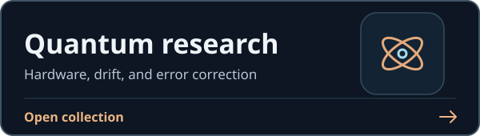

# Quantum research

I run experiments on quantum hardware and study how calibration drift, noise, and experimental controls affect what the results can support.

[Browse this field in the interactive portfolio](https://billyrdavis1985-bot.github.io/billyrdavis1985-bot/?field=quantum#explore)

## Start with the hardware evidence

| Project | What to explore |
| --- | --- |
| [QEC-P1](https://github.com/billyrdavis1985-bot/IRMB_QEC-P1_DriftAware_RepetitionCode) | A drift-aware repetition-code pilot. The paper, preregistration, job provenance, and published error log document what worked and what failed. |
| [QNN-P1](https://github.com/billyrdavis1985-bot/IRMB_QNN-P1_DriftArchive_HardwareValidation) | A calibration-archive noise model compared with hybrid quantum-neural-network runs on hardware. Read the paper and reproduction guide together. |
| [QPU Drift Collector](https://github.com/billyrdavis1985-bot/qpu-drift-collector) | The observational infrastructure behind calibration research: raw snapshots, deduplication, and collection health checks. |

## Trace the coordination experiments

| Study | What to explore |
| --- | --- |
| [Design 3: Bell coordination](https://github.com/billyrdavis1985-bot/IRMB-Phase7G-Design3-BellCoordination) | Early quantum-modulated model-council experiments and their measurement distributions. |
| [Design 4: quantum coordination](https://github.com/billyrdavis1985-bot/IRMB_Phase7G_Design4_QuantumCoordination) | A wider claim-evaluation study across quantum and classical conditions, with an underpowered outcome reported. |
| [Design 5: quantum causality](https://github.com/billyrdavis1985-bot/IRMB_Phase7G_Design5_QuantumCausality) | A preregistered causal test that reports a reversal and identifies decoherence and council dropout as confounds. |

Differences in measurement distributions alone do not establish an advantage in downstream reasoning. These links preserve the progression of the experiments, including null results, reversals, and limits on interpretation.

[Quantum execution tools](tools.md) · [All fields](README.md) · [Current research](../current-research.md) · [Profile](../../README.md)
