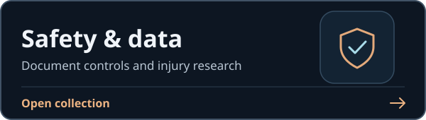

# Safety & data

My manufacturing background drives the workplace-safety research. The security projects explore how software can verify evidence, apply rules, and preserve a record of decisions.

## Start here

| Project | What to explore |
| --- | --- |
| [ForgeVigil](https://github.com/billyrdavis1985-bot/ForgeVigil) | An AI-assisted document-request investigator with deterministic policy checks and an auditable decision record. The profile includes a recorded offline fixture demo and its transcript. |
| [WIPS](https://github.com/billyrdavis1985-bot/WIPS-Preflight-OSHA-2024) | Research on injury-risk signal in public OSHA records. The repository separates the preflight study from a dashboard prototype using synthetic data. |
| [Governed execution conformance](https://github.com/billyrdavis1985-bot/gec-conformance) | A preregistered protocol comparing both decisions and their stated reasons against frozen predictions. Its README records specification-boundary findings and remaining execution prerequisites. |
| [Sakila data pipeline](https://github.com/billyrdavis1985-bot/sovereign_data_pipeline_sakila) | A MySQL, Bash, and Python reference workflow for ingestion, processing, and serving. Its roadmap connects the sample-data work to later OSHA integration. |

## See the work in use

- [ForgeVigil walkthrough](https://forgevigil.com)
- [ForgeVigil evidence page](https://forgevigil.com/evidence)
- [Recorded offline demo and reproduction steps](../forgevigil-demo.md)

The linked repositories describe each project's validation and maturity. A sample-data pipeline, a synthetic dashboard, and a research protocol each demonstrate different parts of the work.

[All fields](README.md) · [Current research](../current-research.md) · [Profile](../../README.md)
