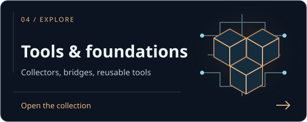

# Tools & foundations

The supporting work makes experiments easier to run, inspect, and repeat. These projects connect local tooling, cloud execution, telemetry, and reusable evidence.

[Browse this field in the interactive portfolio](https://billyrdavis1985-bot.github.io/billyrdavis1985-bot/?field=tools#explore)

| Project | What to explore |
| --- | --- |
| [QPU Drift Collector](https://github.com/billyrdavis1985-bot/qpu-drift-collector) | Hourly IBM calibration collection, raw-first storage, SQLite replay, and collection health monitoring. |
| [AWS Quantum Bridge](https://github.com/billyrdavis1985-bot/Quantum-Bridge-AWS) | A documented Google Colab-to-AWS Braket execution bridge, including authentication and hardware testflight steps. |
| [Azure Quantum Activation](https://github.com/billyrdavis1985-bot/Azure-Quantum-Activation) | A Colab-to-Azure Quantum activation protocol with backend setup and recorded testflight results. |
| [Neural Replay Pack](https://github.com/billyrdavis1985-bot/neural-replay-pack) | Experimental capture and replay of model failures, divergences, and nondeterministic behavior as reusable artifacts. |
| [Frontier claim dataset build](https://github.com/billyrdavis1985-bot/IRMB_Design5_Dataset_MultiAgent_Build) | The documented model-council process used to construct a frozen scientific-claim dataset for the coordination studies. |

Provider setup instructions and hardware availability can change. The project repositories preserve the original procedures, evidence, and context.

[AI & agents](ai-agents.md) · [Quantum research](quantum.md) · [All fields](README.md) · [Profile](../../README.md)
